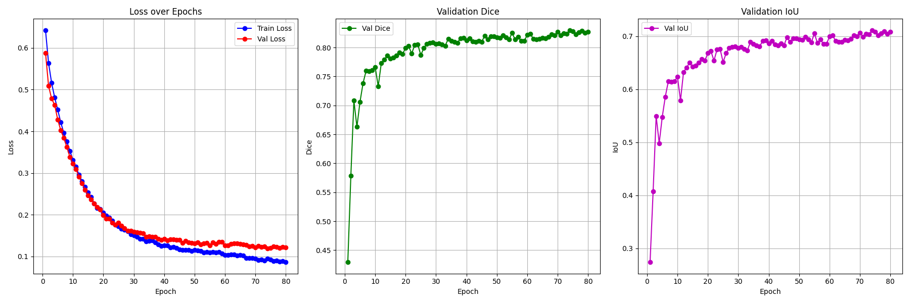

# UNet Brain Tumor Segmentation

A web application for brain tumor segmentation using deep learning with UNet architecture.

## 🧠 Features

- **Brain Tumor Detection**: Upload medical images and get AI-powered tumor segmentation
- **Interactive Web Interface**: Modern, responsive design with drag-and-drop functionality
- **Test Dataset**: Browse and test with pre-loaded medical images
- **Real-time Results**: View original image, predicted mask, and overlay visualization
- **Ground Truth Comparison**: Compare predictions with actual annotations (when available)

## 🛠️ Technology Stack

- **Backend**: Flask (Python)
- **AI Model**: UNet++ with ResNet34 encoder
- **Deep Learning**: PyTorch, Segmentation Models PyTorch
- **Frontend**: HTML5, CSS3, JavaScript
- **Image Processing**: OpenCV, PIL

## 📦 Local Development

### Prerequisites

- Python 3.12+
- pip

### Installation

1. Clone the repository:
```bash
git clone https://github.com/KhanhNguyen2712/Unet_Segmentation_Project.git
cd Unet_Segmentation_Project
```

2. Install dependencies:
```bash
pip install -r requirements.txt
```

3. Run the application:
```bash
python demo/backend/app.py
```

4. Open your browser and visit `http://localhost:5000`

## 📁 Project Structure

```
Unet_Segmentation_Project/
├── demo/
│   ├── backend/
│   │   └── app.py                 # Flask application
│   ├── frontend/
│   │   ├── index.html            # Web interface
│   │   ├── main.css              # Styles
│   │   └── main.js               # Client-side logic
│   └── static/
│       ├── images/               # Test images
│       └── masks/                # Ground truth masks
├── main/
│   └── unet-segmentation-project.ipynb  # Training notebook
├── unet_best.pth               # Pre-trained model
├── requirements.txt            # Python dependencies

```

## 🎯 Usage

### Upload New Image
1. Drag and drop an image file into the upload area
2. Or click to select a file from your computer
3. Wait for the AI to process and display results

### Test with Sample Images
1. Use the dropdown menu to select from pre-loaded test images
2. View the prediction alongside ground truth annotations
3. Compare model performance with actual tumor locations

## 🔧 API Endpoints

- `GET /`: Main web interface
- `POST /predict`: Image prediction endpoint
- `GET /health`: Health check for monitoring
- `GET /static/images/<filename>`: Serve test images
- `GET /static/masks/<filename>`: Serve ground truth masks

## 📊 Model Details

- **Architecture**: UNet++ with ResNet34 encoder
- **Input Size**: 256x256 pixels
- **Output**: Binary segmentation mask
- **Threshold**: 0.5 for tumor detection
- **Framework**: PyTorch with Segmentation Models PyTorch

## 🖼️ Training & Evaluating Result


## 🤝 Contributing

1. Fork the repository
2. Create a feature branch (`git checkout -b feature/amazing-feature`)
3. Commit your changes (`git commit -m 'Add amazing feature'`)
4. Push to the branch (`git push origin feature/amazing-feature`)
5. Open a Pull Request


## 🙏 Acknowledgments

- UNet++ architecture for medical image segmentation
- Segmentation Models PyTorch library
- Brain tumor dataset contributors
- Open source community

## 🔗 Links
- Kaggle Notebook and Outputs: https://www.kaggle.com/code/khanh2k5/unet-segmentation-project
- Dataset: https://www.kaggle.com/datasets/pkdarabi/brain-tumor-image-dataset-semantic-segmentation

⭐ **Star this repository if it helped you!** ⭐
